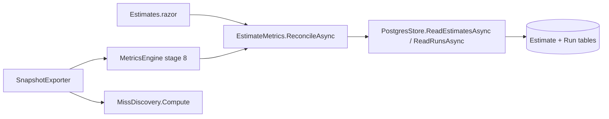
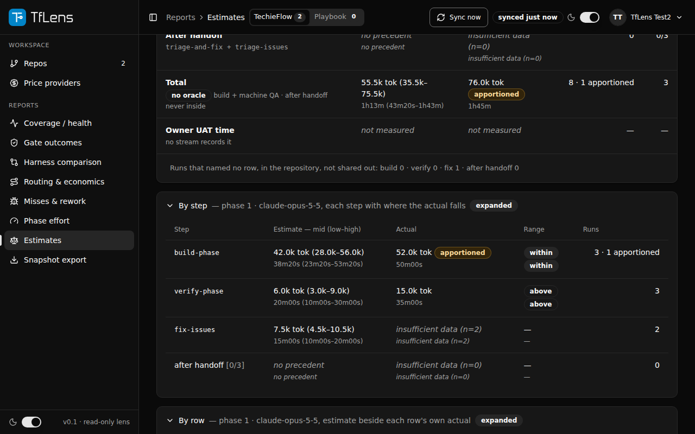
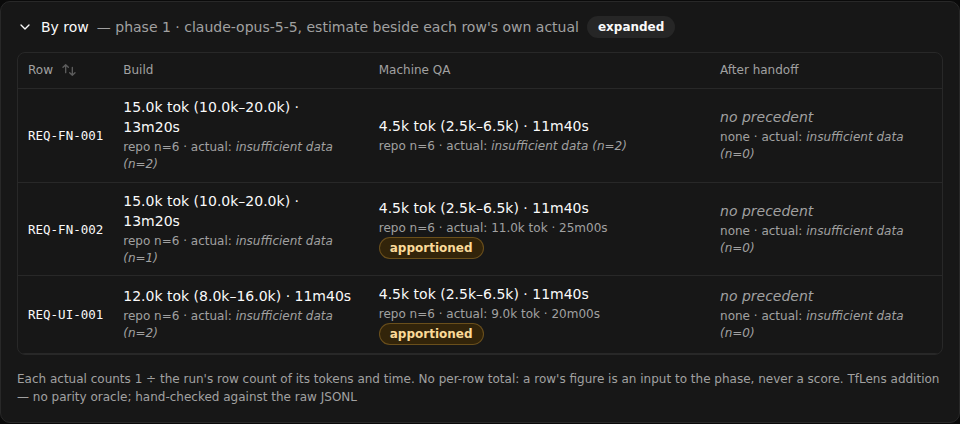

# TfLens — Developer Guide (Phase 4: Estimates)

| | |
|---|---|
| App | TfLens |
| Kind | app |
| Size | Large |
| Phase | 4 of 4 |
| Verified on | 2026-11-12 |
| Date | 2026-11-12 |

The phase 1 to 3 screens are mapped in [TfLens-DevGuide.md](./TfLens-DevGuide.md); this guide holds what phase 4 added.

## Architecture cheat-sheet

| Layer | Project or folder | What lives here |
|---|---|---|
| UI | `src/TfLens/Components/Pages/Estimates.razor` | the page, its cards, By step, By row; figures through `FigureText` |
| Figures | `src/TfLens.Core/Metrics/EstimateMetrics.cs`, `OracleText.cs`, `MissDiscovery.cs` | the reconciliation, the `_k`/`_hms` text, discovery cost |
| Data access | `src/TfLens.Core/Storage/PostgresStore.cs` | `ReadEstimatesAsync`, `WriteChecklistAppAsync` |
| Ingest | `StreamParser.cs`, `Dedupe.cs`, `RepoSyncRunner.cs`, `TelemetryImportService.cs` | the `estimates` stream; the checklist app name |

## Roles and menu map

| Role | Test user | Menu items and the screen each opens |
|---|---|---|
| Manager | user 1 or user 2 | Reports → Estimates (`/estimates`), after Phase effort |

## Screen-by-screen code map

### Estimates (`/estimates`)

**Call chain:** `Estimates.razor:LoadAsync` → `EstimateMetrics.ReconcileAsync` → `PostgresStore.ReadEstimatesAsync` + `ReadRunsAsync` → `"Estimate"`, `"Run"` (joined to `"UserRepo"` by framework, never to each other)

| File and line | Function | Watch | Expected value |
|---|---|---|---|
| `src/TfLens/Components/Pages/Estimates.razor:458` | `LoadAsync` | `vResult.Phases.Count` | 3 for the Sample app; 0 for Sample empty and the Playbook |
| `src/TfLens/Components/Pages/Estimates.razor:480` | `LoadAsync` | `vLoad == objLoadNumber` | true; a stale overlapping load returns before assigning |
| `src/TfLens.Core/Metrics/EstimateMetrics.cs:100` | `ReconcileAsync` | `vEstimates.Count` | 44 for the Sample app |
| `src/TfLens.Core/Metrics/EstimateMetrics.cs:220` | `ComputeCard` | `vCovered["build-phase"]` | the rows whose build estimate had a figure |
| `src/TfLens.Core/Metrics/EstimateMetrics.cs:452` | `ActualFor` | `vShare` | `hits ÷ reqs_count`, capped at 1 |
| `src/TfLens.Core/Storage/PostgresStore.cs:288` | `ReadEstimatesAsync` | returned rows | only this user's, this framework's |

**Calculations on this screen:** `EstimateMetrics.ComputeCard` (latest forecast batch, covered rows, three parts, Total over build + verify + fix), `ActualFor` (apportioned share, MIN_N floor), `OracleText.Kilo`/`Hms` (`OracleText.cs:35`, `:60`; the framework script's rounding, half to even on the exact value).

**Runtime:** renders, signed in as user 2 with the Sample app seeded (`tests/verify/seed/estimates.sh`), light and dark, 1280 and 390; mockup comparison clean over 424 controls (2026-11-12).

## Cross-cutting flows

### Discovery cost and the checklist app name (export, BRD-220)
**Call chain:** `SnapshotExporter` → `MissDiscovery.Compute` → `SnapshotJson.PerMissCost`; sync `RepoSyncRunner.RecordChecklistAppAsync` / import `TelemetryImportService` → `PostgresStore.WriteChecklistAppAsync` → `MetricsEngine` `per_repo[].app`

| File and line | Function | Watch | Expected value |
|---|---|---|---|
| `src/TfLens.Core/Metrics/MissDiscovery.cs:37` | `Compute` | `vMeasured.Count` | misses whose `discovery_scope` is set and not `not-measured` |
| `src/TfLens.Core/Metrics/MissDiscovery.cs:98` | `FixCostOf` | `vShare` | 1 for a run's only fix; n when the run repaired n misses |
| `src/TfLens.Core/Export/SnapshotJson.cs:413` | `PerMissCost` | `vRow` | `discovery`, then `fix` beside it, never summed |
| `src/TfLens/Services/Sync/RepoSyncRunner.cs:208` | `RecordChecklistAppAsync` | `vNames` | the `docs/` file names at the synced SHA |
| `src/TfLens.Core/Import/TelemetryImportService.cs:283` | `CommitAsync` | `vChecklistApp` | the name before `-Checklist.md`, or null for several |
| `src/TfLens.Core/Metrics/MetricsEngine.cs:280` | `PerRepoFactsFor` | `vRepo.ChecklistApp` | used only when no record names an app |

### Configuration, logging, errors
No setting changes any figure here (REQ-NFR-009, REQ-NFR-027). A failed `docs/` listing logs a warning in `RepoSyncRunner.cs:208` and never fails the sync.

## Known issues

- The app name is read only on a sync that finds new telemetry; an unchanged repository keeps its name until the next change (BRD-220).
- The export banner reads NOT QUOTABLE until the parity procedure is re-run against the framework script of 2026-11-08.
